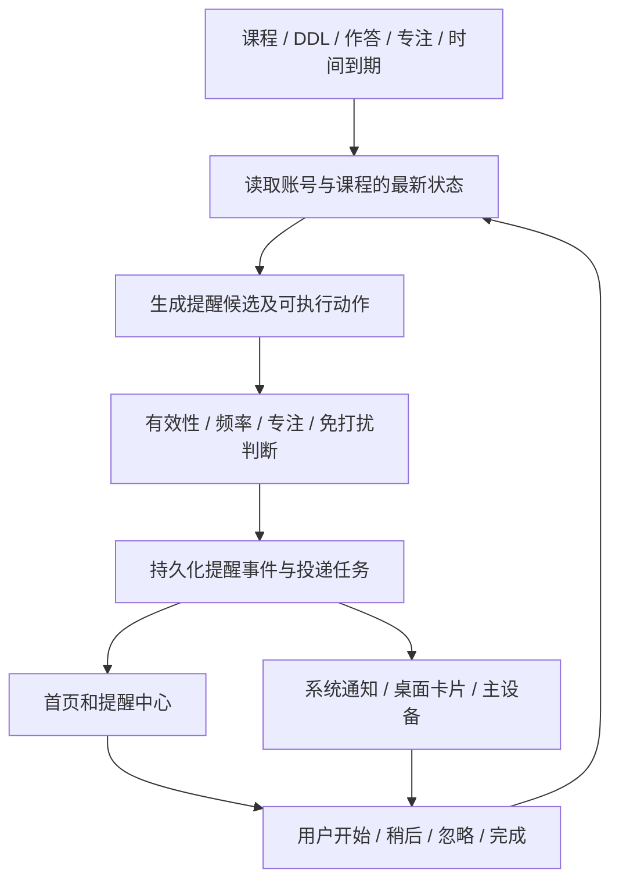

# 知学 Mate：主动服务、多 Agent 协同与界面完整改造方案

日期：2026-10-29。本文是拟实施方案，除“现状”明确列出的能力外，不代表已经完成开发或真机验收。

## 1. 改造目标与范围

最终体验：恢复登录后，无需提问即可看到有依据的今日重点；重要事项在授权和频率控制下通过合适渠道触达；点击后进入对应任务；完成练习后学情与计划更新，旧提醒同步失效。

本轮统一交付：

1. 对话首页的今日重点、下一步行动和简洁的今日任务。
2. 持久化的提醒事件、频率控制、稍后提醒、忽略与完成状态。
3. 服务端事件处理与时间到期检查，以及云推送接入。
4. 手机、已添加的桌面卡片、平板的统一内容和处理状态。
5. 真实设备支持时验证手机通知同步至手表。
6. 按场景选择参与角色的多 Agent 协作，以及可核对的协同依据和成本。
7. 核心页面统一视觉、完整状态和一套可重复验收的演示用例。

独立手表应用不作为手机端闭环的依赖。手表独立运行、表端操作回传、手机不在身边时触达，分别列为额外能力，不能用通知同步代替验收。

## 2. 当前可复用的实现

| 现状 | 本轮处理 |
|---|---|
| 默认启动 `ChatMain`，未连接开屏主动建议 | 保留默认对话页，在顶部接入统一的今日重点 |
| `agent/proactive.py` 已判断 DDL、学习间隔、考试和掌握度 | 重构为按课程、按任务的候选事件生成器，保留旧接口兼容 |
| `Index` 已读取主动决策，但通用推荐卡未实际接入当前页面结构 | 复用请求思路，首页和学习页改读同一份服务端结果 |
| `ProactiveSurfaceService` 在应用切后台时请求并发布通知 | 改为投递适配层；切后台不能决定是否额外创建一条提醒 |
| `LearningCardService` 保存决策快照、更新已注册卡片 | 加入事件标识、数据归属和失效状态，统一内容源 |
| 测评后可更新掌握度并触发计划重排 | 保留真实闭环，补齐统一事件、页面反馈和指标 |
| 秘书、诊断、规划、练习、测评角色及工作流已有实现 | 按需要调度，统一交接内容，减少重复读取和模型调用 |
| 持久化仓储已有事务、批量保存、条件更新接口 | 在现有存储上增加提醒记录和任务，不为本轮另建一套数据库 |
| 当前模块声明 phone、tablet、2in1 | 手表支持先做设备与平台能力验证，不直接添加设备类型冒充适配完成 |

## 3. 用户完整体验

### 3.1 打开应用

身份恢复完成后自动读取一次今日概览。先显示同一账号的有效缓存，再更新结果；不自动发送聊天消息，不为每次打开创建完整 Agent 工作流。

首页结构固定为：

```text
知学 Mate                         提醒入口
今天，10 月 29 日

今日重点
操作系统实验明天截止
预计 30 分钟；今天可用时间 40 分钟
[开始任务]        稍后提醒
为什么建议现在做 ›

接下来
线性表基础练习                   10 分钟
查看今日安排 ›

对话 / 历史消息 / 输入框
```

上例为演示数据，不代表用户的真实课程与截止时间。卡片最多突出一件事，其他事项放简洁列表。没有风险时展示下一项正常任务；没有任务时给轻量引导；没有学情时不把未评估知识点当成薄弱点。

提示是页面内卡片。系统通知是另一个渠道，拒绝通知权限不影响首页建议。

### 3.2 点击与处理

- “开始任务”：进入明确任务，带事件、课程、任务和当前版本，不进入泛泛的功能首页。
- “查看安排”：存在冲突时展示安排方案、依据及变更，用户采用后执行；不把查看等同于同意改计划。
- “稍后提醒”：默认 30 分钟，可选择 15/30/60 分钟；受免打扰和投递上限约束。
- “今天不再提醒”：当天停止该事项同等级的再次打扰；次日是否重提醒仍受规则控制。
- 查看详情不等于完成。完成、删除、修改截止时间会重新检查提醒有效性。
- 打开过的卡片不因为重新进页、刷新或切后台重新变成“新提醒”。

### 3.3 做完练习

服务端只判分一次，保存测评证据、更新画像，并按条件对已有对应计划进行调整。前端展示一张结果摘要：

> 本轮结果已更新。线性表仍需巩固，下一次安排增加了基础练习；作业截止安排保留。

“变化依据”可展开查看具体知识点、前后数值、任务时长和计划版本。没有实际计划变化时明确显示无需调整，不能只增加版本来制造协同效果。

## 4. 提醒内容、分级与排序

以下为拟定默认规则，统一放配置中，依据试用结果调整。

| 等级 | 候选条件 | 首页 | 系统通知 |
|---|---|---|---|
| 紧急 | 未完成任务在 6 小时内截止；或已逾期且仍待处理 | 置顶，并给明确处理动作 | 授权后可触达，仍遵守免打扰与额度 |
| 重要 | DDL 距离 6～48 小时；考试 7 天内且本课程有已评估薄弱点；明确时间预算与待办安排冲突 | 今日重点候选 | 每日摘要中合并提醒 |
| 普通 | 考试 8～14 天的复习建议；有真实记录证明学习间隔达到 2 天；其他非紧急补弱 | 正常建议或任务列表 | 默认不单独推送 |

排序先比较硬截止风险，再考虑已确认的可用时间、课程重要性、已评估薄弱程度和先修影响。同等级按实际截止时间和可执行性排序，使用稳定的顺序，避免同分事项刷新后跳来跳去。

必须修正的口径：

- 每门课使用自己的考试日期、知识点和证据，不能用 A 课程的倒计时拼接 B 课程的薄弱点。
- 没有学习记录表示未知，不能直接解释成“两天没学习”。
- 未评估不等于掌握度差；缺少评估时推荐建立基线。
- 没有可用时长时不声称“今天时间不够”；只在必要时请用户补充一次。
- 时间精确到分钟的截止条件必须有准确时间依据。只有日期时显示日期，采用何种日末约定必须明确展示并允许修改。
- 提醒中的任务名、预计用时、日期、完成状态来自结构化数据。模型可以辅助表达，不能决定或改写这些事实。
- 系统通知默认只放必要信息；详细得分、错题等内容留在应用内。

## 5. 提醒频率与状态

### 5.1 默认频率

- 每日摘要：每天第一次有效打开时生成；外部摘要通知默认最多一次，可设置接收时段。
- 外部主动通知：每个账号每日最多两次，其中普通摘要最多一次，紧急或风险升级最多再一次。
- 同一事项同等级：当天默认最多一次外部提醒。
- 两次外部主动通知默认至少相隔 4 小时；“稍后提醒”可以按用户明确选择的时间触达，但仍计入当天总额度。
- 免打扰默认 22:00～08:00，按用户时区执行；紧急事项默认也不突破。用户主动开启紧急例外后才允许例外触达。
- 正在专注：记录候选事件，暂缓投递；结束后重新检查，不能把已经完成的事项补发出来。
- 已完成、删除、过期失效：取消尚未发送的任务，并更新应用内提示。
- 同一任务小幅数值变化不算新风险。跨越紧急等级、截止时间实质改变等才允许升级判断。

上述规则同时适用于手机和平板，不能每台设备各算一份额度。首页卡片刷新不计作外部提醒次数。

### 5.2 持久化状态

业务事件状态：待处理、稍后提醒、今日忽略、已开始、已完成、已失效。

渠道投递状态独立保存：待发送、发送中、平台接受、送达（仅有真实回执时）、失败、取消、点击。平台接受请求不能记为用户已读或已送达。

去重依据采用账号、事件类型、业务对象、风险等级和投递日期；普通页面刷新或画像版本增加不能绕过去重。

## 6. 统一架构与后端改造



### 6.1 持久化记录

在现有仓储增加四类数据，不在页面中各自维护一套规则：

| 数据 | 主要内容 |
|---|---|
| 提醒事件 | 账号、课程、业务对象、等级、标题、依据、动作、状态、来源版本、有效期 |
| 提醒偏好 | 开关、类别、免打扰、摘要时段、频率、紧急例外、时区 |
| 投递任务 | 事件、渠道、设备、预定时间、去重键、重试、状态和平台回执 |
| 设备绑定 | 当前账号、设备标识、Push Token、能力、最近活跃时间、有效状态 |

多 Agent 的输出仍使用现有工作流、证据和计划记录，补充结构化交接与调用指标。

### 6.2 事件与时间触发

业务触发包括：身份恢复完成、课程或 DDL 变更、任务完成、可用时间变更、练习提交、专注开始与结束。

时间触发包括：进入风险窗口、稍后提醒到期、摘要时段到期。它们由独立服务端 worker 读取持久化任务处理，不依赖应用保持后台运行，不在每个 Web worker 启动一个重复扫描线程。

使用当前持久化后端提供任务领取、租约和事务。业务保存与事件记录在同一事务内；外部发送通过持久化待发队列处理。发送前再次检查账号归属、完成状态、版本、权限、免打扰和额度。

外部投递不能假设天然“恰好一次”：内部使用稳定事件与投递标识、发送领取锁和平台支持的折叠机制降低重复；失败重试有上限，并保存真实状态。

### 6.3 接口边界

新增兼容接口，具体命名在实现时统一：

- 今日概览：返回今日重点、简短任务列表、数据时间、当前版本和待处理计数。
- 提醒列表：分页读取当前账号的事件。
- 提醒动作：开始、稍后提醒、今日忽略；带事件版本和幂等键。
- 提醒偏好：读取与保存设置。
- 设备绑定：注册、刷新与解绑当前账号设备，接收平台 Token 更新。

生产决策以服务端已保存的数据和登录身份为准。旧 `/agent/proactive` 接口保留兼容；客户端传入的任意掌握度和倒计时不能直接成为生产通知依据。

同步更新根契约、前端契约镜像、ArkTS 模型、响应校验、Fixture 和相关测试，不能只改页面字段。

## 7. 系统通知、桌面卡片与手表

### 7.1 应用进程不存在时的触达

现有本地发布通知入口不能承担应用长期关闭后的时间提醒。需要服务端时间检查，加上适用的系统调度或云推送通道；本方案选择服务端调度与华为 Push Kit 对接。

华为官方说明，Push Kit 建立云到端通道，可在应用进程不存在时推送；其“后台消息”与可展示的通知消息语义不同，因此提醒应按通知消息接入，不能把后台消息当成用户可见通知。[Push Kit 官方说明](https://developer.huawei.com/consumer/cn/doc/harmonyos-guides/push-kit-introduction)

接入前置项：开发者侧服务开通、应用和签名匹配、服务器鉴权、终端 Token、通知授权以及真实设备。缺少这些项时，页面与后端事件闭环仍可验收，但“关闭应用后可提醒”必须标为未验收，不用截图或模拟开关替代。

### 7.2 手机与平板

应用前台优先展示应用内卡片，避免同一事项再弹一条系统通知。后台投递选择一个有效主设备，设备离线或 Token 失效时按策略重试或切换，不能同时向所有端广播。

所有设备读取同一个事件。任意一端处理后，其他端在下一次状态同步时更新。支持平台撤回或更新时调用相关能力；断网设备不能承诺即时消失。

桌面卡片读取同源事件快照；业务动作在打开应用后校验事件有效性。失效、完成或账号切换时更新文案，不保留可执行的旧任务。

### 7.3 手表分两个验收层级

**本轮优先：手机通知同步到手表。** 华为官方说明，这依赖兼容设备连接、运动健康应用中的通知同步设置，以及手机应用实际产生通知。具体提醒模式也受设备设置影响。[华为手表通知说明](https://consumer.huawei.com/cn/support/content/zh-cn15958978/)

先核对实际手机与手表的型号、系统、配对和通知支持，再用真实项目通知测试。验收描述为“该设备组合下手机通知已同步显示到手表”。仅显示通知时，不宣称可在表端开始任务、回传完成或独立运行。

**独立手表应用：** 只有明确需要表端交互，且具备设备、对应 SDK 与联调条件时再实施。它需要单独验证身份绑定、能力协商、操作回执和离线处理。本轮数据模型预留渠道能力，不让手机端闭环依赖该扩展。

系统通知同步可能由平台决定手机和手表是否同时振动；应用内的去重不能替代系统提醒模式，演示时明确设备设置和控制边界。

## 8. 多 Agent 协同设计

### 8.1 按场景调度

| 场景 | 执行路径 |
|---|---|
| 查考试日期、查 DDL、读已有任务 | 结构化查询直接响应 |
| 打开首页、刷新提醒 | 规则与已有数据计算，默认不调用大模型 |
| 解释现有画像或计划 | 复用证据，必要时一次模型解释 |
| 新学习目标、多约束安排 | 秘书组织 → 必要诊断 → 规划；需要练习时再进入练习角色 |
| 用户提交练习 | 测评 → 条件成立时交规划 → 更新计划与提醒 |
| 图片题目分析 | 使用已有视觉流程，确认题目与课程后再接学习闭环 |

保留现有五个角色，但不让所有请求固定经过五次模型调用。角色价值由职责、工具和输入输出体现；规则完成的步骤如实标明规则处理。

### 8.2 协作协议

一次任务共享同一份账号、课程、目标、画像、DDL、时间预算与计划版本快照。每次交接携带：当前目标、已知事实、证据标识、硬约束、待确认信息、建议动作、输入输出版本。

- 诊断 Agent 负责学情与证据，不直接改计划。
- 规划 Agent 综合截止时间、学习需求与可用时间，产出可执行安排及变更。
- 练习 Agent 按已选课程和知识点取题，不覆盖当前学习目标。
- 测评 Agent 根据实际提交更新结果，必要时交回规划。
- 秘书 Agent 负责调度、缺项澄清和冲突收口，不让不同角色同时写同一计划。

独立读取可并行，依赖诊断结果的规划按顺序执行。模型调用有总预算、超时和取消；复用有效结果，避免重复读取资料、重复出题、重复写画像。

### 8.3 协同必须展示的额外收益

固定演示场景：用户今天可用 40 分钟；一项作业明天截止、预计 30 分钟；某知识点练习结果较差，完整补弱预计还需 30 分钟。

仅按薄弱程度排序容易全部安排练习；仅按 DDL 排序容易忽略学情。协同方案应根据真实约束，给出例如“30 分钟作业 + 10 分钟有依据的基础巩固，剩余补弱待后续安排”，并说明未完成部分。若所有要求确实无法满足，明确呈现冲突，不虚构足够时间。

有题目或课程资料支持先修关系时，诊断可指出更基础的困难，规划据此改变任务内容；缺乏证据时列为待确认，不能把推测写成已知学情。

下一次提交结果改善后，再检查是否还需要维持补弱安排。这条“学情影响计划、期限和时间预算约束计划、测评再反馈”的链路作为协同价值的核心展示。

### 8.4 速度与成本验收

记录每一步耗时、模型调用次数、Token 用量（供应方提供时）、工具调用、缓存命中、失败回退和最终计划变化。用户页面只展示真实进度和结果；详细指标放协同依据或演示报告。

采用同一批至少 30 个固定场景，对比统一单 Agent 基线和按需协同。保持模型、输入数据、工具权限和预算口径可比，记录最终质量与成本，而非只比较生成文字长短。

比较指标：截止约束违规、超出可用时间、课程或知识点归属错误、无证据结论、可执行动作覆盖、计划冲突、人工复核结果以及总耗时、模型调用和 Token。只对有实测收益的复杂场景使用协同；简单查询不为展示协同而增加等待。

性能目标而非当前保证：同账号有效缓存首屏约 300ms 内可见；正常测试网络下今日概览 P95 争取 2 秒内；简单查询不引入额外模型调用；复杂文字安排首个有效进度争取 1 秒内、主体结果 P95 争取 15 秒内。图片和现场出题单独统计，不混入文字场景指标。测量需记录环境、样本量和冷暖启动，未达标则保留实际结果。

## 9. UI 改造规则

### 9.1 固定信息架构

- 保留“对话 / 智能体 / 学习 / 我的”导航，减少路由和学习成本的同时统一内容。
- 对话：今日重点、最多两项接下来任务、聊天内容和输入框；有历史时首页提示保持简洁可折叠。
- 学习：今日安排、课程与 DDL、知识库、画像、错题和复盘的管理入口。
- 智能体：保留能力介绍与协同过程入口，页面文案重点解释各角色解决什么问题。
- 我的：账号、提醒设置、设备与通知状态，明确展示是否授权和最后同步时间。

### 9.2 视觉与交互

参考 Todoist Today 的今日任务聚合、优先级和可调整安排，结合 HarmonyOS 原生控件统一实现。参考信息层级和交互，不直接搬运品牌素材。[Todoist 今日视图](https://www.todoist.com/help/todoist/get-started/plan-your-day-with-the-today-view-UVUXaiSs)

统一一套组件：提醒卡、任务行、状态标签、主按钮、次要文字入口、空状态、错误重试和可展开依据。建议蓝色只用于主要动作，紧急事项用有限红色提示；状态标签不伪装成按钮；去掉成排 Emoji 和装饰性徽章。

基础布局采用统一间距阶梯和字号层级，明确正文、标题、辅助说明；触控区域沿用合适的原生尺寸并通过真机验证。每个主要操作区域只突出一个主动作，危险操作放独立菜单。

知识画像保留本轮已整理的操作层级；未评估与低掌握度明确区分。计划页优先展示今天做什么、用多久、变化了什么，细节和证据折叠。对话页不重复叠加 AI 浮标，其他页面入口避开底部操作区。

“为什么这样安排”展示事实、证据和约束，不暴露模型隐藏推理，不把虚构的角色对话当成运行轨迹。加载状态对应真实步骤，网络失败保留可辨识的旧数据时间并给重试。

## 10. 文件与改造边界

| 范围 | 主要涉及 |
|---|---|
| 提醒规则与事件 | `app/agent/proactive.py`、`app/api/proactive.py`、新增提醒状态与策略服务 |
| 时间检查与投递 | 新增独立提醒 worker、持久化投递服务、Push Kit 适配器 |
| 协同与计划 | `runtime/orchestrator.py`、现有角色、`assessment_replan.py`、计划接口和证据记录 |
| 开屏展示 | `ChatMain.ets`、今日概览 ViewModel、统一提醒卡组件 |
| 通知与卡片 | `ProactiveSurfaceService.ets`、`LearningCardService.ets`、`EntryAbility.ets`、表单扩展 |
| 页面与设置 | `Index.ets`、`StudyPlan.ets`、`StudyTags.ets`、`Account.ets` 及提醒设置页面 |
| 契约与验证 | 根契约及前端镜像、模型、响应校验、Fixture、规则与生命周期测试 |

实现时复用当前接口和流程，做向后兼容的增量字段；不得重置用户课程、学习记录或计划来迁移数据。工作区已有其他改动时单独整理本轮提交，保留其他工作。

## 11. 一次实施的顺序与交付物

本方案在一次改造中完成，内部按依赖顺序分阶段验收，避免末尾才发现平台条件不成立。

1. **先确认外部能力和设计。** 核实 Push 服务、签名、部署进程、目标手机/平板/手表；锁定首页、提醒设置、计划变化页的样稿与状态。不具备的手表独立能力明确排除。
2. **先打通统一状态。** 实现提醒事件、时间判断、去重、用户动作、账号归属与版本校验，用固定时钟测试。
3. **接入开屏与闭环。** 今日概览接入对话首页，完成任务和练习后同步变化；统一学习页与卡片内容。
4. **接入外部触达。** 服务端 worker、云推送、设备注册与解绑、免打扰、失败重试，验证进程不存在时触达。
5. **完善按需协同。** 共用快照、结构化交接、调用预算、真实轨迹和对比数据。
6. **统一 UI 并验收发布。** 核心页面逐屏检查、小屏与大屏适配、运行回归、真实设备通知测试、构建签名包与演示材料。

交付包括：可安装 HAP、后端变更与 worker 启动说明、契约、迁移/回退说明、界面截图、测试报告、协同对比数据、设备兼容记录以及可重复的演示脚本。代码发布和真实设备能力分别报告，不能用构建通过代替投递验收。

## 12. 必须通过的验收

| 场景 | 验收结果 |
|---|---|
| 已有数据账号冷启动 | 不输入、不点建议，自动出现正确今日重点 |
| 新账号、无记录 | 展示建立学情引导，不编造薄弱点、考试或学习间隔 |
| 多课程数据 | 倒计时、作业、知识点和动作归属于同一正确课程 |
| 日期缺少具体时刻 | 不编造小时级倒计时或任意截止时刻 |
| 同分薄弱点 | 推荐文案与实际练习一致，刷新不随机换目标 |
| 连续打开、刷新、前后台切换 | 同一事项不因页面操作重复外部提醒 |
| 稍后提醒、今日忽略 | 跨重启仍生效，并遵守额度与免打扰 |
| 专注与免打扰期间 | 暂缓外部提醒，恢复后只处理仍有效事件 |
| 完成、删除或修改任务 | 队列取消或重算，旧入口提示已处理或刷新状态 |
| 拒绝通知权限 | 首页功能正常，设置中如实显示通知不可用 |
| 应用进程不存在 | 外部条件齐备后，真实手机收到正确云通知 |
| 云推送重复、超时、Token 失效 | 有限重试、稳定标识、可核对状态，不虚报送达 |
| 手机和平板同时在线 | 统一计数，按主设备策略触达，处理状态最终一致 |
| 手表通知同步 | 在记录型号、系统与设置的真实组合上显示项目通知 |
| 账号切换或退出 | 解绑/失效旧投递权限，旧事件不进入新账号页面 |
| 测评触发规划 | 只写入一次，展示真实差异和证据，运行中的任务不被打断 |
| 时间不足 | 安排不超过预算、不越过硬截止；无法满足时明确显示冲突 |
| 重复采用方案、并发提交、旧页面点击 | 幂等与版本校验生效，不能覆盖新计划 |
| Agent 或网络失败 | 展示实际状态与重试，保留确定结果，不假装协同完成 |
| 规则与协同成本 | 固定场景报告可复现，简单查询不经过多次模型调用 |
| 界面 | 主要入口清晰，安全区域无遮挡，加载/空/失败/过期状态齐全 |

最终演示顺序：打开应用自动显示重点 → 查看依据与时间冲突 → 采用安排并开始任务 → 完成一次练习 → 展示画像和计划真实变化 → 演示去重、稍后提醒及授权后的外部触达。具备真实设备条件时再展示手表同步，流程与测试数据分开标识。
