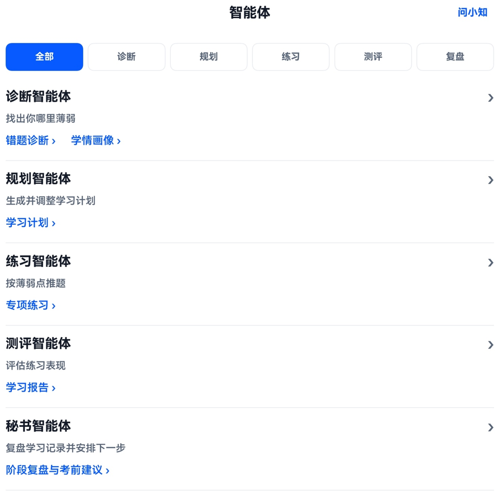
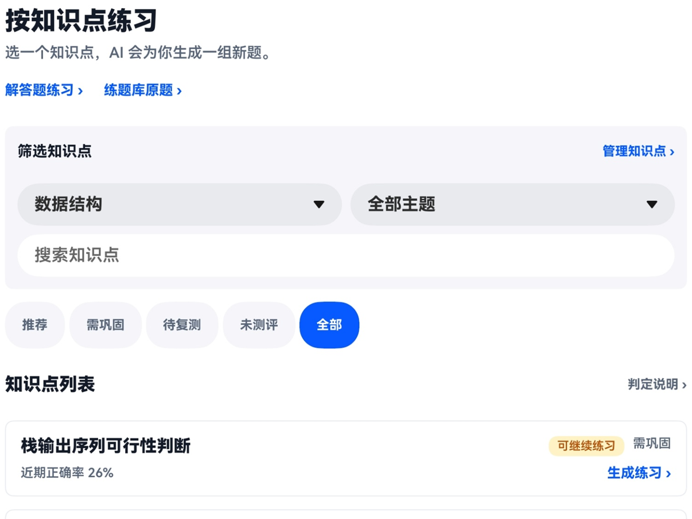
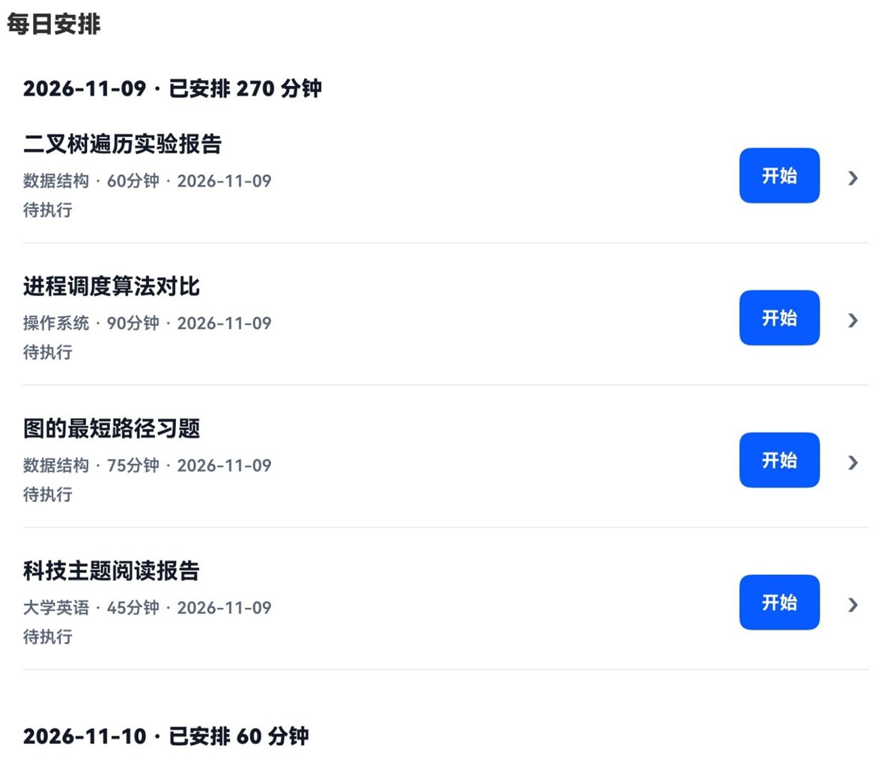
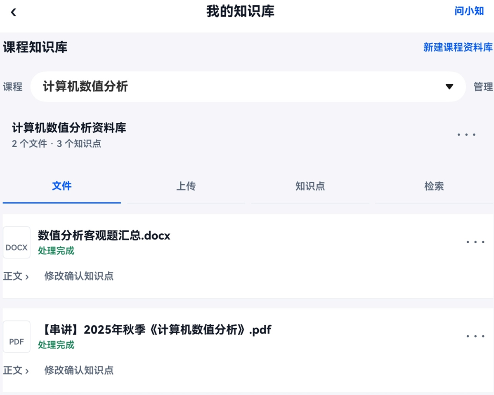

<h1 align="center">知学 Mate（ZhiXue Mate）</h1>
<p align="center"><strong>基于 HarmonyOS 全场景的大学生主动助学 Agent</strong></p>
<p align="center">2026 中国高校计算机大赛 · 人工智能创意赛 · 鸿蒙赛道 · Agent 方向<br>武汉理工大学 · 暗影骑士王们 · 全国总决赛</p>

**决赛版 1.0.13** · HarmonyOS SDK 6.1.1（API 24） · ArkTS / ArkUI · Python 3.12 / Flask · `api-contract-v0.3`

[下载签名 HAP](hap/知学Mate-signed.hap?raw=true) · [云端评审](评委部署指导/00-云端评审快速开始.md) · [本机复现](评委部署指导/02-后端部署.md) · [服务器状态](server/zhixue-agent-server/deploy/香港评审实例.md) · [验收与排障](评委部署指导/04-功能验收与排障.md)

## 先跑起来

1. 安装 [1.0.13 调试签名 HAP](hap/README.md)。使用 API 24 的 DevEco Studio 模拟器，或已获当前调试 Profile 授权、支持 API 24 及以上的 HarmonyOS 真机。
2. 打开应用。评审包默认使用 `https://47.238.218.213`。覆盖安装后如果保留了旧地址，在登录页打开「查看连接设置」，填入该地址，点「应用此地址」和「检测后端连接」。
3. 使用团队交接的评审账号查看已准备的数据。香港实例关闭了共享访客数据，本机自建演示环境可用「跳过登录，在线体验」。无网时选择「离线演示（无需网络）」，查看内置样例。

## 评审服务器

| 项目 | 当前情况 |
| --- | --- |
| 评审 API | 香港 ECS，公网 HTTPS `https://47.238.218.213` |
| 公网探针 | 2026-11-13 实测 `/health` 返回 `200` 和 `{"status":"ok"}`，`/ready` 返回 `200` 和 `{"status":"ready"}` |
| 服务 | Ubuntu 24.04、Nginx、Gunicorn / Flask、独立文档 Worker，由 systemd 管理 |
| 数据 | PostgreSQL 18 存学习数据，SeaweedFS 存私有附件，数据库和对象存储仅在服务器内部监听 |
| 联机验收 | 评审账号登录、学习数据回读和交接附件读取见[实例验收记录](server/zhixue-agent-server/deploy/香港评审实例.md) |

在线评审走公网 HTTPS，安装完成后可以断开调试线。个人数据验收使用团队交接的账号。华为账号、系统推送与跨设备接续需在具备对应授权和系统能力的设备上验证。

## 项目是什么

知学 Mate 把课程、作业截止时间（DDL）、讲义、错题与学习进度放到同一个学习流程里。学生可以通过对话或拍题发起诊断，按知识点练习并查看题源，交卷后回看掌握度和后续计划，还可以与学习搭子共享专注状态。

| 智能体 | 学习流程中的职责 |
| --- | --- |
| 诊断 | 识别薄弱知识点，归纳错因，更新学情画像 |
| 规划 | 按课程、DDL、掌握度和可用时间安排任务，并根据学习结果调整计划 |
| 练习 | 按课程和知识点组织练习，有适用资料时关联讲义题源 |
| 测评 | 批改作答，记录错题与逐知识点评估结果 |
| 秘书 | 汇总待办、提醒与学习进度，组织 Agent 间的任务交接 |

大模型负责自然语言理解、视觉识题和内容生成。服务端记录判分、掌握度与计划状态，并在 Trace 中展示工作流使用的 Agent 和工具。HarmonyOS 端提供宽屏布局、服务卡片、小艺意图入口和跨设备专注接续。

## 应用截图

以下界面截取自决赛作品说明文档，点击可查看原图。

| 五个智能体 | 按知识点专项练习 |
| :---: | :---: |
| [](docs/screenshots/agents.png) | [](docs/screenshots/practice.png) |
| **学习计划与每日安排** | **课程知识库** |
| [](docs/screenshots/study-plan.png) | [](docs/screenshots/knowledge-base.png) |

## 评审演示路线

| 步骤 | 操作与观察点 |
| --- | --- |
| 1 · 准备数据 | 在「课程与作业」导入[课表和 DDL 样例](演示测试数据/指导老师预演-20261028/02-课程与DDL)，核对导入预览的 3 门课程、4 条作业 |
| 2 · 基于资料出题 | 在「知识库」上传[二叉树讲义](演示测试数据/指导老师预演-20261028/03-上传讲义/05_binary_tree_notes.txt)，等待解析后从「专项练习」选课程和知识点，查看题源 |
| 3 · 验证学习闭环 | 提交练习，查看判分、错题、学情与后续任务，在工作流轨迹中查看参与的 Agent 与工具 |
| 4 · 验证记录保存 | 使用同一评审账号重新登录，核对课程、计划和学习记录。需要演示协作时，两台设备接入同一后端并使用各自账号 |

## 代码与部署

```text
HarmonyOS / ArkTS
  └─ 同一 baseUrl → Flask API
                   ├─ /api/agent/chat      学习对话与意图识别
                   ├─ /api/v1/...          账号、计划、练习、学情与协作
                   ├─ PostgreSQL / SQLite  业务数据
                   └─ 文档解析与对象存储   课程资料、附件与题源
```

| 路径 | 用途 |
| --- | --- |
| [app/](app/) | DevEco Studio 工程，35 个注册页面 |
| [server/zhixue-agent-server/](server/zhixue-agent-server/) | API、五个 Agent、Worker、数据库迁移和部署模板 |
| [contracts/openapi.json](contracts/openapi.json) | OpenAPI 真源，`app/contracts/` 存放前端镜像 |
| [hap/](hap/) | 决赛签名 HAP、版本及 SHA-256 |
| [评委部署指导/](评委部署指导/) | 云端、安装、自建、数据库、签名和验收手册 |
| [演示测试数据/](演示测试数据/) · [integration/](integration/) · [tools/](tools/) | 演示样例、联调脚本和自检工具 |

### 本机快速启动（Windows）

在仓库根目录执行。使用 Python 3.12，首次安装依赖需要访问软件包索引；提交 ZIP 另附 Windows x64 离线依赖。

```powershell
git clone https://github.com/LBJ6-23-1230/C4-AI-national-final-by-xzhzyyheb.git ZhixueMate
cd ZhixueMate
$backend = '.\server\zhixue-agent-server'
py -3.12 -m venv (Join-Path $backend '.venv')
& (Join-Path $backend '.venv\Scripts\python.exe') -m pip install -r (Join-Path $backend 'requirements.txt')
$env:ZHIXUE_DB = 'sqlite'
$env:DEMO_ENABLED = 'true'
powershell -NoProfile -ExecutionPolicy Bypass -File .\start-backend.ps1 -Port 5000
```

在另一个终端访问 `http://127.0.0.1:5000/ready`。同机模拟器在 App 中填写 `http://10.0.2.2:5000`，同一可信局域网的真机填写 `http://<开发机局域网IP>:5000`。前端改动用 DevEco Studio 打开 `app/` 并选择 `entry` 模块运行。真实模型对话、图片识题和生成式出题需要在后端配置自己的 `DASHSCOPE_API_KEY`。[后端与 Worker 部署](评委部署指导/02-后端部署.md) · [前端构建与签名](app/README.md)

## 版本与验证

| 项目 | 结果 |
| --- | --- |
| 最新交付 | `1.0.13`（`1000013`），包名 `com.zhixue.mate`，2026-11-12 构建。安装包通过 DevEco 验签，哈希见 [manifest.json](hap/manifest.json) |
| 契约 | 100 个 API 路径，后端真源与前端镜像通过逐字节检查 |
| 后端回归 | 1.0.13 源码共 1,113 项通过，其中 3 项本机 HTTP 用例在支持回环连接的环境中复验通过；31 项需要隔离 PostgreSQL 实例的用例跳过。[验收记录](评委部署指导/07-项目核查与提交清单.md) |
| 前端检查 | 连接检测、聊天流和 79 项请求恢复检查通过 |
| 当前评审环境 | 2026-11-13 实测香港公网健康与就绪探针；设备授权、系统能力和模型功能按[功能验收与排障](评委部署指导/04-功能验收与排障.md)逐项确认 |

## 许可

本项目采用 [MIT License](LICENSE)。赛事信息见 [鸿蒙赛道官网](https://developer.huawei.com/home/C4-AI)。
